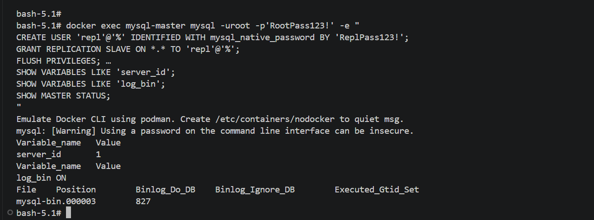
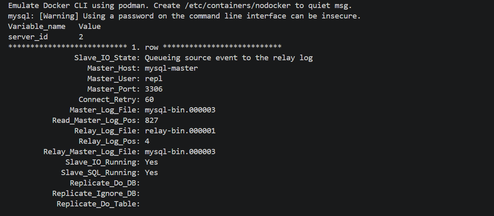
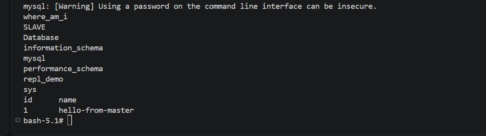

# Домашнее задание к занятию "Репликация. Часть 1" - Дорофеев Максим
## Задание 1
Различия режимов репликации master-slave и master-master.
### Master-Slave (один ведущий - один или несколько ведомых)
- Запись (INSERT/UPDATE/DELETE) идёт только на master.
- Slave получает бинарный лог (binlog) с master и повторяет те же изменения у себя.
- Чтение можно раздавать на slave (разгрузка master), запись - только на master.
- Проще в настройке и сопровождении.
- Минус: если master упал, нужна процедура failover (назначить новый master), иначе запись недоступна.
- Типичный сценарий: один источник правды + реплики для чтения/бэкапов.
### Master-Master (оба узла могут быть источниками записи)
- Оба сервера принимают запись и реплицируют изменения друг другу.
- Плюс: запись можно слать на любой узел, выше доступность записи.
- Минусы: сложнее конфликты (одинаковые автоинкременты, одновременные правки одной строки), нужнее аккуратная настройка (server-id, auto_increment_offset/increment, конфликт-резолюшн).
- Выше риск рассинхрона, если сеть/логика приложения не продуманы.
- Типичный сценарий: активная запись с двух площадок, но требует дисциплины.
### Коротко
| | Master-Slave | Master-Master |
| --- | --- | --- |
| Кто пишет | только master | оба |
| Сложность | ниже | выше |
| Конфликты записи | почти нет | возможны |
| Отказоустойчивость записи | слабее без failover | лучше по задумке |

## Задание 2

Конфигурация master-slave репликации (два контейнера MySQL 8).

### Схема
- mysql-master: server-id=1, log-bin=ON, порт 3307
- mysql-slave: server-id=2, read-only=1, порт 3308
- общая сеть repl-net
- пользователь репликации: repl / ReplPass123!

### Master: пользователь и статус

    CREATE USER 'repl'@'%' IDENTIFIED WITH mysql_native_password BY 'ReplPass123!';
    GRANT REPLICATION SLAVE ON *.* TO 'repl'@'%';
    SHOW MASTER STATUS;

Результат: File=mysql-bin.000003, Position=827, server_id=1, log_bin=ON

### Slave: подключение к master

    CHANGE MASTER TO
      MASTER_HOST='mysql-master',
      MASTER_USER='repl',
      MASTER_PASSWORD='ReplPass123!',
      MASTER_LOG_FILE='mysql-bin.000003',
      MASTER_LOG_POS=827;
    START SLAVE;
    SHOW SLAVE STATUS\G

Результат: server_id=2, Slave_IO_Running=Yes, Slave_SQL_Running=Yes

### Проверка репликации
На master создана БД repl_demo и строка hello-from-master.
На slave те же данные появились автоматически.

